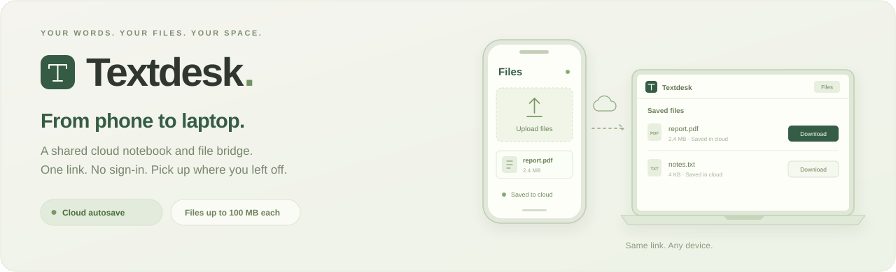
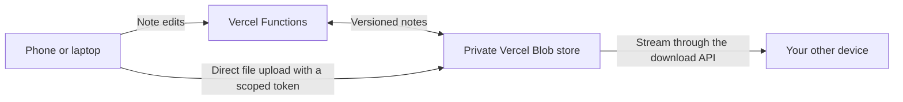

<p align="center"><strong>A shared cloud notebook and a little bridge between your devices.</strong><br />Write on one screen. Upload from another. Pick it all up using the same link.</p>

<p align="center"><a href="https://textdesk-tan.vercel.app"><strong>Open Textdesk ↗</strong></a> &nbsp; · &nbsp; <a href="https://textdesk-tan.vercel.app/#files"><strong>Open Files ↗</strong></a> &nbsp; · &nbsp; <a href="#getting-started">Run it yourself</a></p>

<p align="center">   </p>

---

## One link. Two ways to stay connected.

### A place for your words

Type or paste text into a note and let cloud autosave take care of it. Keep spacing, line breaks, and Unicode intact. Give notes titles, search your library, or switch to focus mode when you want room to write.

### A bridge for your files

Open **Files** on your phone, upload a photo, document, video, or another file, then open the same page on your laptop and download it. Original filenames and file bytes are preserved.

> [!NOTE]
> Textdesk is intentionally a **public shared space**. There are no accounts or sign-in screens. Anyone with the link can read and edit notes, and upload, download, or remove files.

## How to use it

| Step | On your phone | On your laptop |
| --- | --- | --- |
| **1 · Open** | Visit [Textdesk Files](https://textdesk-tan.vercel.app/#files). | Open the same link. |
| **2 · Send** | Tap **Upload files** and select one or more files. | Your saved files appear in the list. Use **Refresh** if needed. |
| **3 · Pick up** | Keep the page open until it says **Saved to cloud**. | Choose **Download** beside the file you need. |

For text, open **Notes**, start writing, and look for **Saved to cloud** before closing the page. Other open devices check for updates automatically.

## What’s included

| Cloud notes | File bridge |
| --- | --- |
| Autosave with a clear cloud status | Multiple file selection and drag and drop |
| Local draft backup and retry after temporary failures | Upload progress, cancellation, and manual retry |
| Titles, full-text search, and focus mode | Downloads with original filenames |
| Copy text or download a `.txt` file | Confirmation before removing a cloud file |
| Export the note library as JSON | A layout that works on phones and desktops |
| Conflicting edits kept as separate notes | File storage separate from the notes library |

## Getting started

### Prerequisites

- **Node.js 20+** and npm; Node.js 24 matches the deployed runtime.
- **Python 3** for the static preview command.
- A **Vercel project and private Blob store** for cloud saving and file transfers.

### Install and build

```bash
git clone https://github.com/jitesh523/text_pdf_cloud.git
cd text_pdf_cloud
npm ci
npm run build
```

### Preview the interface

```bash
npm run dev
```

Open **http://127.0.0.1:5173**.

This command serves the interface only. Cloud saving and uploads need Vercel Functions; the static preview does not run those APIs.

### Run with cloud storage

1. Import this repository into your own Vercel project.
2. Create and connect a **private Vercel Blob store**, including the Development and Production environments you plan to use.
3. Ensure the server has `BLOB_READ_WRITE_TOKEN`, which issues scoped file-upload tokens. See [.env.example](.env.example).
4. Link your checkout to that project and start the Vercel development server:

```bash
npx vercel login
npx vercel link
npx vercel env pull .env.local
npx vercel dev
```

Keep the token server-side. `.env.local` is ignored by Git, and storage credentials do not belong in browser code.

The deployment settings are already in [vercel.json](vercel.json):

| Setting | Value |
| --- | --- |
| Framework | Other |
| Install command | `npm ci` |
| Build command | `npm run build` |
| Output directory | `dist` |

The hosted app currently uses Node.js 24. Set the Node.js version separately in your own Vercel project settings.

## How cloud saving works



**Notes** save after a short typing pause. The browser keeps a local draft backup and retries temporary cloud failures. Version checks preserve conflicting edits instead of silently overwriting another device’s text. **Saved to cloud** appears only after server confirmation.

**Files** upload directly from the browser to Blob using a short-lived token restricted to a fresh file path. Downloads stream through the app. Files remain available until removed.

The backing store is private, while the app’s notes and file APIs deliberately provide public access. This keeps storage credentials on the server; it does not make the shared contents private to a visitor.

## Limits and useful details

| Item | Limit or behavior |
| --- | --- |
| File size | **100 MiB per file**, shown as 100 MB in the interface |
| Notes | Up to **300 notes**, within **1 MiB** for the complete notes document |
| File types | Any type with a supported filename |
| Uploads | Files upload in sequence; cancelled or failed uploads can be retried |
| Refresh | Open pages check periodically; Files also has a Refresh button |
| Connectivity | Cloud operations require an internet connection |
| Persistence | Notes and completed uploads live in Blob, rather than only in browser storage |

## Project map

```text
api/                 Cloud notes, file listing, upload tokens, and downloads
dist/                HTML, CSS, and browser JavaScript
lib/                 Storage handlers and filename utilities
src/files.js         File bridge interface and upload queue
scripts/build.mjs    Browser bundle build using esbuild
tests/               Persistence, sync, uploads, and API tests
docs/assets/         README artwork
```

The app uses plain HTML, CSS, and JavaScript. esbuild bundles the uploader into `dist/files.js`; the other interface files live directly in `dist/`.

############## Checks

```bash
npm test
npm run build
```

Tests cover exact text preservation, cloud conflicts and retries, upload queues, size limits, filenames, scoped upload tokens, and streamed binary downloads. They use mocked storage and API responses, so they run without production credentials.

A separate live check verified a **6 MiB multipart upload and download with matching SHA-256 hashes**, including its original Unicode filename. See [DEPLOYMENT.md](DEPLOYMENT.md) for the verification record.

## Helpful references

- [Vercel Blob client uploads](https://vercel.com/docs/vercel-blob/client-upload)
- [Vercel local development](https://vercel.com/docs/cli/dev)
- [Blob SDK reference](https://vercel.com/docs/vercel-blob/using-blob-sdk)

---

<p align="center"><strong>Textdesk</strong><br />A place for words to stay. A way for files to move.</p>
